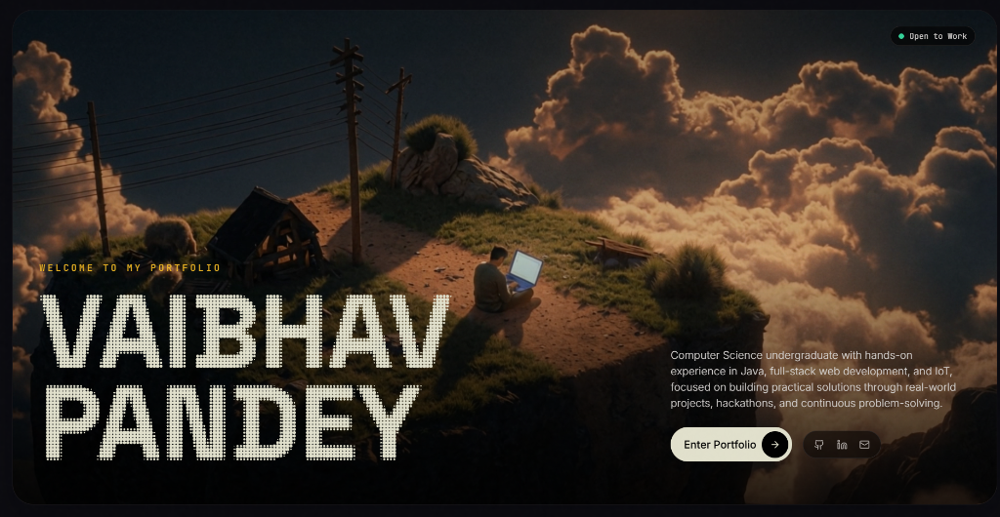

3D Developer Portfolio
A personal portfolio built around an immersive 3D environment, interactive skills, and selected engineering projects.

Live Demo · Report a Bug · Request a Feature

Overview
This portfolio is designed to present my work as a developer through an interactive, spatial experience rather than a traditional static résumé. A dark visual environment, purposeful motion, and project-focused content bring the interface together while keeping the information accessible and easy to explore.

The experience combines an immersive 3D room with a scroll-driven 3D Skills section and dedicated areas for projects, experience, education, achievements, and certifications.
Highlights
- Immersive 3D environment — a room-inspired interface that gives the portfolio a distinctive visual identity.
- Interactive Skills section — a 3D, scroll-driven presentation of technical skills.
- Project showcase — selected projects, concise summaries, technology details, source-code links, and live demos where available.
- Experience & Education — a structured overview of technical work, leadership, and academic background.
- Achievements & Certifications — dedicated spaces for competition results and genuine professional credentials.
- Responsive interface — layouts designed for desktop, tablet, and mobile screens.
- Motion with purpose — transitions and interactions that support navigation without overwhelming the content.
Tech Stack
Keep this list aligned with the dependencies actually used in the repository.

Area	Technology
UI	React, TypeScript
Styling	Tailwind CSS / project styling system
3D graphics	Three.js and/or React Three Fiber, depending on the implementation
Motion	Existing animation library and CSS transitions
Tooling	Node.js and the package manager configured by the project
Version control	Git and GitHub

Getting Started
Prerequisites
- Node.js installed on your machine.
- Git.
- The package manager used by this repository (npm, pnpm, or yarn).
Installation
git clone YOUR_REPOSITORY_URL
cd YOUR_REPOSITORY_DIRECTORY
npm install
npm run dev
Open the local URL printed by the development server.

If the repository uses pnpm or yarn, use that package manager's install and run commands instead. Check package.json for the exact scripts supported by the project.
Production build
npm run build
Run any available lint or type-check scripts from package.json before deploying.
Project Sections
Section	Purpose
3D Room	Creates the portfolio's immersive entry experience.
Skills	Presents technical skills through an interactive 3D visual.
Projects	Highlights selected work with relevant source and demo links.
Experience & Education	Summarizes professional, community, leadership, and academic experience.
Achievements	Showcases verified competition placements, awards, and recognition.
Certifications	Lists genuine professional courses and credentials when available.

Customization
Most personal portfolio content should be updated in the project's existing data source and components rather than duplicated across the UI.
1. Update personal details and section content using the current data structure.
2. Add project titles, concise descriptions, technologies, and real repository/demo URLs.
3. Use genuine screenshots or locally stored assets for project previews.
4. Keep achievement records separate from professional certifications.
5. Test the 3D experience and all sections at desktop and mobile widths after making changes.
Do not publish placeholder links, fabricated metrics, or unverified credentials as real information.
Performance & Accessibility
The portfolio combines visual effects with content that visitors need to read and navigate. When extending it:
- Keep 3D assets and textures appropriately sized.
- Avoid adding a second heavy rendering scene when a CSS transform or lightweight effect will do.
- Provide usable touch interactions on mobile rather than relying on hover.
- Respect prefers-reduced-motion where animations are used.
- Maintain readable contrast, keyboard navigation, and visible focus states.
- Check for layout shifts, overflow, and console errors before publishing.
Deployment
Deploy using the platform already supported by your project setup (for example, Vercel or another static/frontend hosting service).

Configure the build command and output directory according to the framework and scripts in package.json. Add environment variables only if the application actually requires them, and never commit secrets to the repository.
Feedback
Found a problem or have a suggestion? Open an issue in this repository with clear reproduction steps or a description of the proposed improvement.
License
No license is specified here. Add a LICENSE file and update this section before allowing others to reuse, modify, or redistribute the code. If the project is intended to remain proprietary, make that clear in the repository.

Designed to make engineering work feel like an experience.

